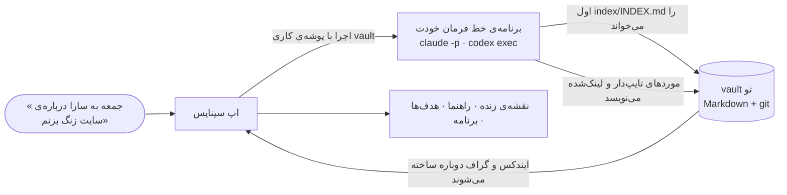

<div align="center">


# سیناپس (Synapse)

</div>

<div dir="rtl" align="center">

**مغز دومی که خودش خودش را مرتب می‌کند.**

با آن حرف بزن؛ خودش ثبت می‌کند، به هم وصل می‌کند، برنامه می‌ریزد و مرور می‌کند —<br>
در فایل‌های ساده‌ی مارک‌داونی که مال خودت است، با همان اشتراک هوش مصنوعی‌ای که الان داری، و همه را به شکل نقشه‌ای زنده از ذهنت نشان می‌دهد.

[English](README.md) · **فارسی**

</div>

<div align="center">

[](LICENSE)


%20·%20English-f59e0b)


</div>

<div dir="rtl">

## فهرست

[شروع کار](#شروع-کار) · [چطور کار می‌کند](#چطور-کار-می‌کند) · [امکانات](#امکانات) · [حریم خصوصی](#حریم-خصوصی-و-امنیت) · [راهنمای کاربران ایران](#راهنمای-کاربران-داخل-ایران) · [پرسش‌های رایج](#پرسش‌های-رایج) · [مشارکت](#مشارکت)

## سیناپس چیست؟

سیناپس یک «مغز دوم» و سیستم‌عامل زندگی است که از اول با هوش مصنوعی ساخته شده. یادداشت‌ها، ایده‌ها، کارها، پروژه‌ها، هدف‌ها، عادت‌ها، آدم‌ها و روزنوشت‌هایت به شکل یک پوشه از فایل‌های مارک‌داون روی دیسک خودت نگه داشته می‌شوند. لازم نیست هیچ‌وقت مرتبشان کنی: هر چه در ذهنت هست را در یک جمله، فارسی یا انگلیسی، می‌گویی و مغزِ سیناپس آن را به شکل مورد درست ثبت می‌کند، به چیزهایی که به آن ربط دارند وصلش می‌کند و تصویر کلی را به‌روز نگه می‌دارد. این تصویر را به شکل یک نقشه‌ی زنده می‌بینی و هر روز مغز به تو می‌گوید چه چیزی ارزش وقت گذاشتن دارد.

مغز سیناپس سرویسی نیست که ما اجرا کنیم. **اشتراک هوش مصنوعی خودت است**: سیناپس همان برنامه‌ی خط فرمان رسمی و دست‌نخورده‌ای را اجرا می‌کند که خودت در آن وارد شده‌ای (Claude Code یا OpenAI Codex) و پوشه‌ی کاری‌اش را vault تو قرار می‌دهد. نه کلید API لازم است، نه حساب کاربری پیش ما، و سیناپس هیچ‌وقت رمز یا اطلاعات ورود تو را نمی‌بیند.

> **⚠️ مغز خودت را بیاور.** در این مخزن **هیچ دسترسی‌ای به هوش مصنوعی** نیست: نه کلید API، نه توکن، نه حساب مشترک و نه اشتراک کس دیگری. کلون کردنش فقط اپ را به تو می‌دهد، نه مغز را. برای اینکه فکر کند به **اشتراک فعال خودت** نیاز داری:
>
> - **Claude**: پلنی که Claude Code را دارد (مثلاً Pro یا Max) و روی سیستم خودت در Claude Code وارد شده باشی، **یا**
> - **ChatGPT**: پلنی که Codex را دارد (مثلاً Plus یا Pro) و روی سیستم خودت در Codex وارد شده باشی.
>
> هر درخواست از کامپیوتر *خودت*، با برنامه‌ی واردشده‌ی *خودت*، به حساب *خودت* می‌رود و هزینه‌اش به حساب هیچ‌کس دیگری نوشته نمی‌شود. راه‌اندازی دو دقیقه طول می‌کشد: [فعال کردن مغز](#۲-فعال-کردن-مغز).

## چرا سیناپس؟

مغزهای دوم معمولاً به‌خاطر کمبود امکانات کنار گذاشته نمی‌شوند؛ به‌خاطر زحمت نگه‌داری‌شان کنار گذاشته می‌شوند. پوشه، تگ، قالب و لینک همه کارند، و همین که زندگی شلوغ می‌شود سیستم عقب می‌افتد و رها می‌شود. ابزاری مثل Obsidian کنترل کامل می‌دهد و مسئولیت کامل را هم روی دوش تو می‌گذارد؛ اپ‌های یادداشت هوشمند زحمت را برمی‌دارند ولی فایل‌هایت را هم با خودشان می‌برند.

سیناپس روی یک ایده‌ی دیگر ساخته شده: **بایگانی با هوش مصنوعی، فایل‌ها مال تو.**

- **مال خودت:** یک پوشه‌ی ساده از مارک‌داون با frontmatter و لینک‌های `[[...]]`. ابسیدین بازش می‌کند، هر ویرایشگری می‌خواندش و از خود این اپ بیشتر عمر می‌کند.
- **بی‌زحمت:** در یک جمله ثبت کن. نوع، دسته، لینک‌ها و موعدش را مغز تعیین می‌کند.
- **برگشت‌پذیر:** هر کاری که مغز انجام می‌دهد یک commit در تاریخچه‌ی git همان vault است و با یک کلیک برمی‌گردد.
- **خصوصی:** همه‌چیز محلی است. چیزی از دستگاهت بیرون نمی‌رود جز آنچه مغزِ انتخابی‌ات برای جواب دادن می‌خواند. روی مک کل vault در یک دیسک رمزنگاری‌شده با AES-256 است که با رمز خودت یا Touch ID باز می‌شود.
- **مستقل:** اشتراک خودت، موتور خودت، و انتخاب مدل و میزان فکر کردن با خودت — هر وقت بخواهی عوضش کن.

## چطور کار می‌کند



۱. **تو حرف می‌زنی:** در کادر پیام می‌نویسی یا با میکروفون می‌گویی، یا مستقیم در صندوق ثبت می‌کنی.

۲. **مغز تو اجرا می‌شود:** سیناپس همان `claude` (یا `codex`) واردشده‌ی تو را با پوشه‌ی vault، مهارت مناسب (ثبت، پرسش، مرور، برنامه‌ریزی…) و یک زمینه‌ی کوتاه — تاریخ، زبان، آنچه روی صفحه است — اجرا می‌کند.

۳. **اول ایندکس:** مغز یک ایندکس کوچکِ ساخته‌شده توسط اپ را می‌خواند (دستورهای همیشگی‌اش زیر ۲٫۵ هزار توکن است) و فقط فایل‌هایی را باز می‌کند که لازم دارد؛ برای همین جواب‌ها حتی با هزاران مورد هم سریع و کم‌هزینه می‌مانند.

۴. **فایل ساده می‌نویسد:** موردهای تازه و تغییرکرده به شکل مارک‌داون در `nodes/` ذخیره می‌شوند و کل اجرا در تاریخچه‌ی git همان vault ثبت می‌شود.

۵. **تو می‌بینی:** سرور ایندکس و گراف را دوباره می‌سازد و نقشه همان موردهایی را که مغز به آن‌ها دست زده روشن می‌کند — زنده، همان لحظه که کار می‌کند.

## امکانات

- **🧠 حرف بزن، مرتب نکن:** یک کادر برای ثبت، سؤال و گفتگو؛ جواب به همان زبانی که نوشتی؛ دیکته‌ی صوتی در مرورگر.
- **🌌 نقشه‌ی زنده‌ی ذهن:** نقشه‌ای با WebGL که دسته‌ها در آن ناحیه‌های درخشان‌اند و هر نوع مورد شکل خودش را دارد؛ جزیره‌هایی برای دنیاهای جدا (یک کسب‌وکار، یک پیج، *کاراکتر خودت*) که هر کدام کلیدی برای وصل یا جدا بودن دارند؛ و دیدنِ خواندن و نوشتنِ مغز که در لحظه روی لینک‌ها حرکت می‌کند.
- **🧭 راهنمایی که می‌گوید الان چه مهم است:** کارهای عقب‌افتاده و امروزی، کارهای در جریان، عادت‌های امروز، اولویت‌های خود مغز و سؤال‌هایی که ترجیح می‌دهد از تو بپرسد تا اینکه حدس بزند.
- **🎯 هدف‌ها همراه کارهایشان:** هر هدف با حلقه‌ی پیشرفت، دلیلش و تاریخ هدف، و زیرش پروژه‌ها، کارها، عادت‌ها و تصمیم‌هایی که جلو می‌برندش؛ همان‌جا تیکشان بزن.
- **🗓️ برنامه و مرورها:** برنامه‌ی روزانه، مرور کامل که موارد کهنه را بایگانی و اولویت‌ها را از نو مرتب می‌کند، و مرور هفتگی — دستی یا زمان‌بندی‌شده؛ اگر روزی جا بماند، دفعه‌ی بعد که اپ باز شود جبران می‌شود.
- **🗂️ دسته‌ها و جزیره‌ها، از کل به جزء:** برای هر کدام یک صفحه با همه‌ی محتوایش، آنچه توجه می‌خواهد، یک تحلیل و نقشه‌ی کوچک خودش.
- **📥 صندوقی که مغز خالی‌اش می‌کند:** یادداشت‌های سریع آنجا می‌مانند تا مغز همه را یک‌جا سر جایشان بگذارد.
- **🔗 vault تو داخل اپ‌های دیگر هوش مصنوعی:** سیناپس یک سرور MCP با ورود OAuth خودش است؛ به Claude، ChatGPT، Claude Code یا Codex وصلش کن تا بتوانند موردهایت را جستجو کنند، بخوانند و اگر اجازه بدهی تغییر بدهند.
- **🔒 رمزنگاری‌شده روی مک:** اپ دسکتاپ vault را در یک دیسک رمزنگاری‌شده با AES-256 نگه می‌دارد که با رمز تو یا Touch ID باز می‌شود، همراه با کلید بازیابی و یک نسخه‌ی پشتیبان رمزنگاری‌شده.
- **📱 هر جا که هستی:** اپ مک، سروری که خودت با داکر راه می‌اندازی، یا مرورگر؛ گوشی را روی همان وای‌فای با یک کد QR وصل کن و به صفحه‌ی اصلی اضافه‌اش کن.
- **🌗 فارسی و انگلیسی، روشن و تیره:** رابطی که از اول راست‌به‌چپ طراحی شده با امکان تغییر به انگلیسی، ساعت ۲۴ساعته و حالت روشن که صفحه‌به‌صفحه بررسی شده.
- **↩️ برگشت، پشتیبان و انتقال:** هر کار مغز قابل برگشت است؛ کل vault را خروجی بگیر و در یک قدم به یک سیناپس دیگر ببر.

## تصویرها

</div>

| | |
|---|---|
|  |  |
| <div dir="rtl">**نقشه‌ی ذهن:** دسته‌ها، جزیره‌ها و هسته</div> | <div dir="rtl">**راهنما:** آنچه الان به تو نیاز دارد</div> |
|  |  |
| <div dir="rtl">**هدف‌ها:** هر هدف با کارهایی که به آن خدمت می‌کنند</div> | <div dir="rtl">**نقشه‌ی اختصاصی هر دسته**</div> |

<div dir="rtl">

## شروع کار

### ۱. پیش‌نیازها

- **Node.js 22** یا بالاتر (`node -v`)
- **pnpm 9** (`npm install -g pnpm@9` یا `corepack enable`)
- **git**
- **اشتراک فعال Claude یا ChatGPT متعلق به خودت** (قدم ۲)

### ۲. فعال کردن مغز

یکی را انتخاب کن (یا هر دو را، و در هر گفتگو بینشان جابه‌جا شو). ورود همیشه **داخل برنامه‌ی خود شرکت سازنده** انجام می‌شود، نه داخل سیناپس.

**Claude Code (پیشنهادی):**

</div>

```bash
npm install -g @anthropic-ai/claude-code   # نصب
claude                                     # بعد بنویس /login و با حساب Claude خودت وارد شو
claude auth status                         # بررسی
```

<div dir="rtl">

**Codex:**

</div>

```bash
npm install -g @openai/codex   # نصب
codex login                    # ورود با حساب ChatGPT خودت
codex login status             # بررسی
```

<div dir="rtl">

ترمینال دم دستت نیست؟ سیناپس را اجرا کن و از **تنظیمات ← مغز ← ورود** وارد شو: همان فرمان ورودِ خود برنامه اجرا می‌شود و کد یک‌بارمصرفت مستقیم به آن داده می‌شود. در هر دو حالت اطلاعات ورود در پوشه‌ی خود آن برنامه در پوشه‌ی کاربری‌ات می‌ماند؛ نه در سیناپس و نه در این مخزن.

اگر پرداخت به‌ازای مصرف را ترجیح می‌دهی، **کلید API خودت** (Anthropic، OpenAI یا OpenRouter) را در «تنظیمات ← مغز» بگذار. فقط در فایل تنظیمات خصوصی vault خودت ذخیره می‌شود، بیرون از این مخزن.

### ۳. اجرا

| روش | مناسب برای | دستور |
|---|---|---|
| **امتحان** | یک نگاه اول با داده‌ی نمونه | `pnpm install && pnpm vault:seed && pnpm dev` |
| **اپ مک** | استفاده‌ی روزانه روی مک‌های اپل‌سیلیکون، رمزنگاری‌شده | `pnpm install && pnpm mac:dmg` |
| **روی سرور** | گوشی و همه‌ی کامپیوترها، از هر جا | `docker compose up -d --build` |

### اجرا از سورس

</div>

```bash
git clone https://github.com/sinasohrabi9444/synapse-os.git && cd synapse-os
pnpm install
pnpm vault:seed          # یک vault تازه با داده‌ی نمونه‌ی خیالی در ~/Synapse/vault
pnpm dev                 # http://localhost:5173
```

<div dir="rtl">

برای یک vault خالی به‌جای `vault:seed` دستور `pnpm vault:create` را بزن؛ با متغیر `SYNAPSE_VAULT` می‌توانی جای vault را عوض کنی. دستور `pnpm build && pnpm start` همه‌چیز را به شکل یک برنامه روی `http://127.0.0.1:4317` اجرا می‌کند.

بار اول سیناپس برای ساختن حساب مالک یک **کد راه‌اندازی** می‌خواهد که در لاگ سرور چاپ می‌شود (`setup code: XXXX-XXXX-XXXX`). بعد «تنظیمات ← مغز» را باز کن؛ برنامه‌ای که واردش شده‌ای آنجا «وصل» نشان داده می‌شود.

### روی ویندوز

سرور و رابط وب مستقیم روی ویندوز ۱۰ و ۱۱ اجرا می‌شوند (PowerShell یا Git Bash):

</div>

```powershell
npm install -g pnpm@9          # pnpm dev خودش دوباره pnpm را صدا می‌زند، پس باید روی PATH باشد
git clone https://github.com/sinasohrabi9444/synapse-os.git; cd synapse-os
pnpm install
pnpm vault:seed                # vault در %USERPROFILE%\Synapse\vault
pnpm dev                       # http://localhost:5173
```

<div dir="rtl">

اگر فقط corepack داری، یا یک بار `corepack enable` را در ترمینال **Administrator** اجرا کن، یا دو بخش را جدا راه بینداز: `corepack pnpm --filter @synapse/server dev` و `corepack pnpm --filter @synapse/web dev`.

### اپ مک

</div>

```bash
pnpm install
pnpm mac:dmg             # → apps/desktop/release/Synapse-<version>-arm64.dmg
```

<div dir="rtl">

فایل DMG را باز کن و سیناپس را داخل Applications بکش. بار اول یک رمز برای اپ انتخاب کن (و اگر خواستی Touch ID را روشن کن) و **کلید بازیابی‌ای را که فقط یک بار نشان داده می‌شود یادداشت کن**. بستن پنجره vault را قفل می‌کند. این اپ فقط روی همان مکی که ساخته شده امضای محلی دارد؛ روی مک دیگر بار اول راست‌کلیک کن و Open را بزن. جزئیات در [docs/DEPLOY.md](docs/DEPLOY.md#on-a-mac-an-app).

### روی سرور

یک ایمیج داکر سرور، رابط وب و برنامه‌های Claude Code و Codex را با هم دارد. راهنمای [docs/DEPLOY.md](docs/DEPLOY.md) قدم‌به‌قدم راه‌اندازی با Coolify یا داکر ساده، ساخت حساب در اولین اجرا (با کد راه‌اندازی‌ای که در لاگ سرور چاپ می‌شود)، ورود به برنامه‌ها از تنظیمات، HTTPS و پشتیبان‌گیری را توضیح می‌دهد.

## داده‌های تو

</div>

```
~/Synapse/vault/
├── nodes/        موردهای تو: یادداشت، ایده، کار، پروژه، هدف، عادت، آدم، رویداد، روزنوشت، منبع، نقشه…
├── memory/       آنچه مغز درباره‌ی تو می‌داند و یاد گرفته
├── index/        ساخته‌ی خود اپ تا مغز اول آن را بخواند — هیچ‌وقت دستی ویرایش نمی‌شود
├── AGENTS.md     دستورالعمل کار مغز (Codex هم همین را می‌خواند)
└── .claude/      مهارت‌ها و قواعد مغز
```

<div dir="rtl">

هر مورد یک فایل مارک‌داون با frontmatter (نوع، عنوان، خلاصه، وضعیت، موعد، لینک‌ها…) و لینک‌های `[[...]]` با عنوان است؛ قالب دقیقش در [docs/VAULT-SPEC.md](docs/VAULT-SPEC.md) آمده. خود vault یک مخزن git است، پس کل تاریخچه‌اش را داری. می‌توانی یک کپی را در ابسیدین باز کنی، با هر ابزاری از آن پشتیبان بگیری یا از «تنظیمات ← پشتیبان و انتقال» خروجی بگیری.

## موتورهای مغز

</div>

| <div dir="rtl">موتور</div> | <div dir="rtl">ورود با</div> | <div dir="rtl">توضیح</div> |
|---|---|---|
| **Claude Code CLI** | <div dir="rtl">اشتراک Claude خودت (از ترمینال یا از تنظیمات)</div> | <div dir="rtl">اولین و آزموده‌ترین موتور</div> |
| **Codex CLI** | <div dir="rtl">حساب ChatGPT خودت (از ترمینال یا از تنظیمات)</div> | <div dir="rtl">همان دستورالعمل‌های vault</div> |
| **Anthropic API · OpenAI API · OpenRouter** | <div dir="rtl">کلید API در تنظیمات</div> | <div dir="rtl">پرداخت به‌ازای مصرف</div> |

<div dir="rtl">

موتور، مدل و میزان فکر کردن را برای هر گفتگو خودت انتخاب می‌کنی. نحوه‌ی اجرای هر موتور در [docs/BRAIN-ENGINES.md](docs/BRAIN-ENGINES.md) آمده.

## حریم خصوصی و امنیت

- **هیچ‌وقت اطلاعات ورود نمی‌گیرد:** ورود داخل برنامه‌ی خودِ شرکت سازنده انجام می‌شود. وقتی از تنظیمات وارد می‌شوی، سیناپس فرمان ورود همان برنامه را اجرا می‌کند و کد یک‌بارمصرفت را مستقیم به آن می‌دهد؛ نه روی دیسک ذخیره می‌شود نه در لاگ. کلیدهای API فقط در فایل تنظیمات خصوصی vault خودت می‌مانند.
- **محلی، پیش از هر چیز:** سرور فقط روی `127.0.0.1` گوش می‌دهد مگر اینکه دسترسی گوشی را روشن کنی. هر اجرای مغز آنچه را برای جواب دادن از vault می‌خواند برای شرکت سازنده‌ی همان موتور می‌فرستد — کارش همین است — پس موتوری را انتخاب کن که به آن اعتماد داری.
- **رمزنگاری روی مک:** یک دیسک APFS رمزنگاری‌شده با AES-256 که کلید تصادفی‌اش با رمز تو (scrypt)، با کلید بازیابی و در صورت تمایل با Touch ID از طریق Keychain قفل شده.
- **دری قفل روی سرور:** یک حساب مالک که با کد راه‌اندازیِ لاگ سرور ساخته می‌شود، محدودیت تلاش برای ورود، نشست‌هایی که خودت می‌توانی ببندی و تأیید OAuth برای هر اپ هوش مصنوعی‌ای که وصل می‌شود.
- **مغز از محدوده‌اش بیرون نمی‌رود:** فقط ابزار فایل دارد، هیچ سرور MCP دیگری ندارد و یک hook هر نوشتنی بیرون از `nodes/` و `memory/` را رد می‌کند.

### چیزهایی که هیچ‌وقت در این مخزن نیست

- **ورود Claude و ChatGPT:** در پوشه‌ی خود همان برنامه در پوشه‌ی کاربری **خودت** (`~/.claude` و `~/.codex`)
- **کلیدهای API:** در فایل تنظیمات خصوصی vault خودت (`~/Synapse/vault/.synapse/`)
- **فایل `.env`:** در gitignore است؛ فقط `.env.example` خالی در مخزن است
- **یادداشت‌ها و حافظه‌ات:** در vault، که همیشه **بیرون** از مخزن است

پس یک کلون تازه نه حساب کسی را با خودش دارد، نه مصرف و داده‌ی کسی را، و هیچ‌کس نمی‌تواند روی حساب تو اجرا کند.

اگر آسیب‌پذیری امنیتی پیدا کردی، لطفاً خصوصی گزارشش کن — [SECURITY.md](SECURITY.md) را ببین.

## راهنمای کاربران داخل ایران

خود سیناپس هیچ محدودیت منطقه‌ای ندارد و رابطش کاملاً آفلاین کار می‌کند (فونت‌ها داخل خود برنامه‌اند و از هیچ CDN خارجی چیزی بارگذاری نمی‌شود). ولی چند سرویسی که سیناپس به آن‌ها تکیه می‌کند از ایران محدودند. این‌ها را از ایران آزمایش نکرده‌ایم؛ بر اساس محدودیت‌های اعلام‌شده‌ی خود این سرویس‌ها نوشته شده‌اند:

- **مغز (Claude و ChatGPT):** شرکت‌های Anthropic و OpenAI ایران را پشتیبانی نمی‌کنند. هم برای ورود و هم برای هر اجرای مغز باید اینترنتت از یک کشور پشتیبانی‌شده بیاید (معمولاً با VPN) و اشتراک را با کارت پرداخت خارجی خریده باشی. اگر VPN قطع شود، اپ و نقشه و همه‌ی داده‌هایت کار می‌کنند ولی مغز تا وصل شدن دوباره جواب نمی‌دهد.
- **سرور خارج از ایران:** راه پایدارتر این است که سیناپس را روی یک سرور خارج از ایران با داکر راه بیندازی تا مغز از همان‌جا به Claude یا ChatGPT وصل شود و تو فقط با مرورگر از ایران به آن سر بزنی. دامنه و میزبانت باید از داخل ایران در دسترس باشد؛ اگر از CDN داخلی استفاده می‌کنی، [docs/DEPLOY.md](docs/DEPLOY.md) توضیح داده چه مسیرهایی باید بدون چالش مرورگر عبور کنند.
- **نصب بسته‌ها (npm):** اگر `pnpm install` کند است یا قطع می‌شود، از یک میرور داخلی npm (مثل میرورهای Runflare) یا VPN استفاده کن.
- **داکر:** Docker Hub اتصال از آی‌پی‌های ایران را رد می‌کند. برای ساخت ایمیج روی سرور داخل ایران یک registry mirror در `daemon.json` تنظیم کن یا ایمیج را روی سرور خارج بساز.
- **گیت‌هاب:** مخزن‌های عمومی گیت‌هاب از ایران باز می‌شوند؛ ساخت اپ مک یک بار باینری Electron را از گیت‌هاب دانلود می‌کند که روی اینترنت کند ممکن است طول بکشد.
- **قطعی اینترنت:** چون همه‌چیز روی دستگاه خودت است، در قطعی کامل اینترنت هم می‌توانی موردهایت را ببینی، ویرایش کنی و تیک بزنی؛ فقط مغز تا برگشتن اینترنت بین‌الملل منتظر می‌ماند.

## پرسش‌های رایج

</div>

<details>
<summary dir="rtl"><b>باید برای چیزی پول بدهم؟</b></summary>

<div dir="rtl">

سیناپس رایگان و متن‌باز است (مجوز MIT). مغز روی اشتراک هوش مصنوعی یا کلید APIای که همین الان داری اجرا می‌شود؛ سیناپس نه هزینه‌ای اضافه می‌کند نه حسابی می‌خواهد.

</div>
</details>

<details>
<summary dir="rtl"><b>با ابسیدین کار می‌کند؟</b></summary>

<div dir="rtl">

بله. vault مارک‌داونِ سازگار با ابسیدین است. ابسیدین را روی پوشه‌ی vault (یا یک کپی از آن) باز کن؛ هر دو همان فایل‌ها را می‌بینند و سیناپس هر بار که فایلی روی دیسک عوض شود ایندکسش را دوباره می‌سازد.

</div>
</details>

<details>
<summary dir="rtl"><b>داده‌هایم جایی فرستاده می‌شود؟</b></summary>

<div dir="rtl">

فقط برای شرکت سازنده‌ی موتوری که انتخاب کرده‌ای، و فقط همان چیزی که مغز در یک اجرا می‌خواند. سیناپس هیچ سرور و هیچ آمارگیری‌ای ندارد.

</div>
</details>

<details>
<summary dir="rtl"><b>اگر مغز اشتباه کند چه؟</b></summary>

<div dir="rtl">

هر اجرا یک commit در vault توست. از داخل گفتگو برش گردان، یا خودت با git کار کن.

</div>
</details>

<details>
<summary dir="rtl"><b>روی ویندوز، لینوکس یا گوشی کار می‌کند؟</b></summary>

<div dir="rtl">

سرور و رابط وب هر جا که Node.js 22 یا داکر اجرا شود کار می‌کنند و در هر مرورگر امروزی باز می‌شوند. اپ دسکتاپ فعلاً فقط برای مک (اپل‌سیلیکون) است. روی گوشی، از «تنظیمات ← گوشی» با کد QR وصل شو (روی همان وای‌فای) یا وارد سرور خودت شو و آن را به صفحه‌ی اصلی اضافه کن.

</div>
</details>

<div dir="rtl">

## نقشه‌ی راه

سیناپس مرحله‌به‌مرحله ساخته می‌شود؛ [docs/PLAN.md](docs/PLAN.md) همه‌ی مرحله‌ها و قدم بعدی را دارد و [docs/STATUS.md](docs/STATUS.md) می‌گوید الان کجاییم. در راه است: نسخه‌های امضاشده و notarize‌شده‌ی مک، موتورهای بیشتر (مدل‌های محلی)، پیدا کردن موردهای مرتبط با embedding، نسخه‌ی دسکتاپ ویندوز و لینوکس و یک همراه موبایل.

## مشارکت

از هر مشارکتی استقبال می‌کنیم: کد، ترجمه، گزارش باگ و ایده. از [CONTRIBUTING.md](CONTRIBUTING.md) شروع کن. گزارش باگ و پیشنهاد را می‌توانی فارسی هم بنویسی.

این مخزن طوری نوشته شده که هم آدم‌ها و هم ایجنت‌های برنامه‌نویسی بتوانند ادامه‌اش بدهند: نقطه‌ی شروع [AGENTS.md](AGENTS.md) است (Claude Code آن را از طریق [CLAUDE.md](CLAUDE.md) می‌خواند)، مشخصات فنی در [docs/](docs) مرجع اصلی‌اند و قواعد هر بخش در `.claude/rules/` است. همه‌ی فایل‌های کد و مستندات فنی انگلیسی‌اند.

## شرایط استفاده

استفاده از Claude Code یا Codex با اشتراک خودت تابع قوانین همان شرکت است؛ سروری که خودت راه می‌اندازی یک نسخه‌ی شخصی تک‌کاربره است، نه یک سرویس اشتراکی.

## مجوز

سیناپس با مجوز [MIT](LICENSE) منتشر شده و بر پایه‌ی Node.js، Fastify، React، Vite، three.js، d3-force-3d، Tailwind CSS، Radix، TipTap، Motion، Electron و فونت‌های وزیرمتن، استعداد و Inter ساخته شده است.

</div>
